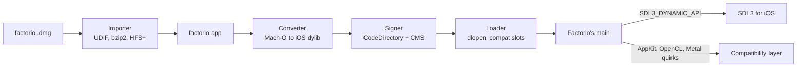

# FactoriOS

Play your own copy of Factorio on an iPhone or iPad. FactoriOS imports the **macOS** build you download from
factorio.com, turns it into a library iOS can load, signs it on the device with your sideloading certificate and runs it
natively, with SDL3 for iOS underneath and a small compatibility layer for the few Mac-only APIs the game uses. No
emulation, no streaming, and none of the game's files in the app.

**Status: written, not yet run.** Nothing here has run on a device. `docs/architecture.md` lists exactly what remains
to be verified there.

## How it works

- [Feasibility](docs/feasibility.md): what the macOS binary needs, from its own load commands and code.
- [Architecture](docs/architecture.md): modules, public APIs, the compatibility map, and what's deferred to a device.
- [Building](docs/building.md): tools, checks, and building the app with xtool.

## Requirements

- An arm64 iPhone or iPad on iOS 17 or later, sideloaded with SideStore, AltStore or xtool and a free Apple ID.
  Which device generations can run the game within their CPU and memory limits remains a device-test gate.
- Factorio for macOS from [factorio.com/download](https://factorio.com/download) (the demo works too).
- The sideloading tool's signing certificate, exported as a `.p12` file, which FactoriOS uses to sign the converted
  game on the device.

## Factorio

Factorio is © Wube Software. FactoriOS isn't affiliated with Wube and includes none of its files.
