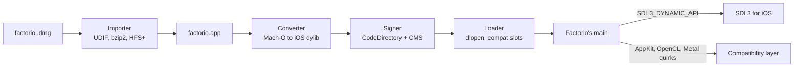

# FactoriOS

Play your own copy of Factorio on an iPhone or iPad. FactoriOS imports the **macOS** build you download from
factorio.com, turns it into a library iOS can load, signs it with the same Apple Development identity used to provision
FactoriOS, embeds it in the app bundle, and runs it natively. SDL3 for iOS and a small compatibility layer replace the
few Mac-only APIs the game uses. No emulation, no streaming, and none of the game's files in the app.

**Status: written and compiled for iOS in CI, not yet run on a device.** Compilation proves no runtime behaviour.
`docs/building.md` defines the device-validation procedure; `docs/architecture.md` lists every deferred result.

## How it works

- [Feasibility](docs/feasibility.md): what the macOS binary needs, from its own load commands and code.
- [Architecture](docs/architecture.md): modules, public APIs, the compatibility map, and what's deferred to a device.
- [Building](docs/building.md): tools, checks, and building the app with xtool.

## Requirements

- An arm64 iPhone or iPad on iOS 17 or later, connected to a Mac with Xcode and installed through the developer's
  Personal Team. Which device generations can run the game within their CPU and memory limits remains a device-test
  gate.
- Factorio for macOS from [factorio.com/download](https://factorio.com/download) (the demo works too).

`mise run device` builds the app, imports and converts the game on the Mac, signs it with the same certificate as the
app, embeds the signed library in the app bundle, and copies the game data to the device, which opens ready to play.
iOS refuses to load code from the app's data container, so the library has to travel inside the app.

This is Apple's developer-owned, connected-device workflow, not App Store or TestFlight distribution. xtool generates
the Xcode workspace from the Swift package; Xcode performs automatic signing and installation. The imported-code
runtime is not App Store eligible. The converted library lives in the installed app bundle and the game data in the
app's container on your own device; neither is in the repository.

## Factorio

Factorio is © Wube Software. FactoriOS isn't affiliated with Wube and includes none of its files.
