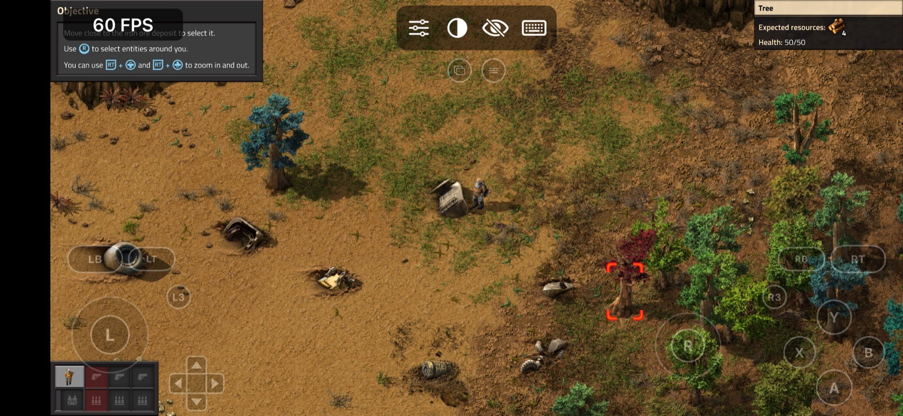
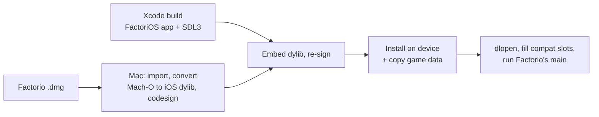

# FactoriOS

Run your own copy of [Factorio](https://factorio.com) natively on an iPhone or iPad. FactoriOS takes the **macOS** build
you download from `factorio.com`, converts it into a library iOS can load, signs it with your Apple Development
identity, and runs it with SDL3 for iOS and a small compatibility layer standing in for the few Mac-only APIs the game
uses. There is no emulation or streaming, and the repository contains no game files.



**Status:** Factorio 2.1.24 runs on an iPhone 14 (A15, iOS 26) at native resolution and 60 FPS with Medium sprites.
Physical controllers and the in-game restart prompt are not yet verified on a device.

## Quick start

You need a Mac with Xcode, an iPhone or iPad on iOS 17 or later, a free Apple Account, and Factorio for macOS (the
[demo](https://factorio.com/download) works).

```sh
git clone --recurse-submodules https://github.com/kmnft/factorios.git && cd factorios
mise install       # pinned toolchain
mise run deploy    # builds, signs, installs and launches FactoriOS with the game
```

[Getting started](docs/getting-started.md) walks through each step, including Xcode and device preparation.

## Documentation

| Guide | For |
|---|---|
| [Getting started](docs/getting-started.md) | Building and installing on your device, step by step |
| [Playing](docs/playing.md) | Launcher, settings, touch controls, saves and logs |
| [Troubleshooting](docs/troubleshooting.md) | Signing, install and game launch problems |
| [Development](docs/development.md) | Tasks, checks, CI, simulator, on-device debugging, new game versions |
| [Architecture](docs/architecture.md) | Modules, the conversion pipeline, launch sequence and compatibility map |
| [AGENTS.md](AGENTS.md) | Orientation for coding agents |

## How it works



## Legal

- **FactoriOS** is released under the [MIT License](LICENSE).
- **Factorio** is a trademark of Wube Software Ltd. FactoriOS is an unofficial fan project, not affiliated with or
  endorsed by Wube Software. It includes no Factorio code, data or assets: you supply your own copy from `factorio.com`,
  and the [Factorio terms of service](https://factorio.com/terms-of-service) still apply to it. They grant personal,
  non-commercial use and forbid distributing the game or altered versions of it, so never share the converted
  library, an app build that contains it, or the game data. The screenshot shows Factorio content, © Wube Software,
  for illustration.
- **SDL3** (zlib License) is the [libsdl-org/SDL](https://github.com/libsdl-org/SDL) submodule in `External/SDL`, built
  from source and embedded in the app; its license is `External/SDL/LICENSE.txt`.
- **LiveContainer** (AGPL-3.0) is cited as prior art for loading an executable as a library. FactoriOS uses none of its
  code.
- **Apple, iPhone, iPad, Xcode and macOS** are trademarks of Apple Inc. FactoriOS installs through Apple's
  developer-owned device workflow. It isn't distributed through, and isn't eligible for, the App Store or TestFlight.
