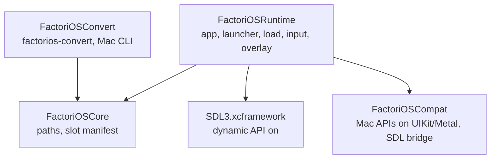
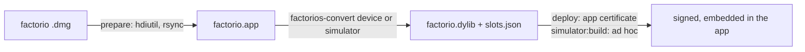
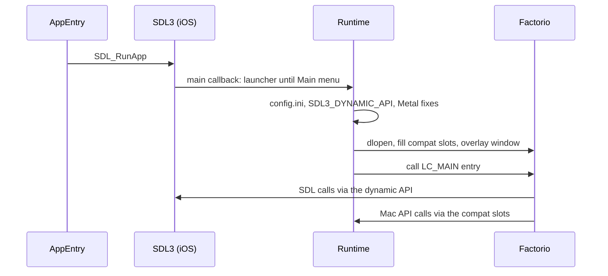

# Architecture

FactoriOS loads Factorio's unmodified macOS game code into an iOS app. Only the packaging and the system calls the
game reaches change.

## Modules

| Module | Main types |
|---|---|
| `FactoriOSCore` | `GamePaths`, `GameLibrary`, `SymbolSlotManifest` |
| `FactoriOSRuntime` | `AppEntry`, `GameSession`, `GameLoader`, `CompatTable`, `SDLGameInput`, `PadController`, `TouchGestures`, `OverlayViewController`, `GameSettings`, `FactorioConfig`, `LauncherScene` |
| `FactoriOSCompat` | `FOSReplacements.m`, `FOSMetalFixes.m`, `FOSTextureCompression.m`, `FOSSDL.m`, `FOSWindowFrame.m` |
| `FactoriOSConvert` | `GameConverter`, `LoadCommandRewriter`, `BindStreamWalker`, `FatBinary` |

## Preparing the game

The converter's changes to the arm64 slice:

| Change | Why |
|---|---|
| `LC_BUILD_VERSION` retagged to iOS or iOS Simulator | dyld refuses another platform's image |
| `MH_EXECUTE` → `MH_DYLIB`, `LC_ID_DYLIB` added, `LC_LOAD_DYLINKER` dropped | `dlopen` needs a library |
| `__PAGEZERO` shrunk to one page | a running process can't map 4 GB at zero |
| Framework paths flattened | iOS frameworks have no `Versions/A/` |
| Mac-only frameworks and binds made weak | they resolve to zero; the compat layer fills what the game reaches |
| CoreServices `_nan` rebound to libSystem | the only Mac-only import reached while loading |
| Signature removed, slots recorded | re-signed on the Mac; slots patched after `dlopen` |

iOS loads code only from the app bundle, so the library is embedded there. Game data goes to
`Library/Application Support/FactoriOS/Game`.

## Launch

- **SDL:** the game's static SDL3 forwards to the app's SDL3 through `SDL3_DYNAMIC_API`. Official iOS builds compile
  the dynamic API out, so [`sdl3`](../mise-tasks/sdl3) builds it from `External/SDL`.
- **One run per process:** the game's static state can't be reset; the app exits with the game. `execv` becomes a
  "reopen FactoriOS" prompt.
- **Load order:** `dlopen` runs the game's static initializers before the slots are filled; none reaches a replaced
  symbol.
- **Background:** `nextDrawable` waits while the app is in the background, where iOS forbids GPU work.
- **Paths:** `read-data` is the imported game, `write-data` is `Documents/Factorio` (visible in Files).

## Compatibility map

Every Mac API the game reaches. Symbols fill the converter's recorded slots; Objective-C rows patch live classes.

| Mac API | FactoriOS | Does |
|---|---|---|
| `_NSApp` | `fosNSApp` | nil; menu-bar code messages nil |
| `NSAppleEventManager` | `FOSAppleEventManager` | empty class |
| `NSBitmapImageRep` | `FOSBitmapImageRep` | ImageIO decode to RGBA; `bitmapData`, size, format and color-space conversion |
| `NSColorSpace` | `FOSColorSpace` | sRGB and generic RGB `CGColorSpace` |
| `NSWorkspace` | `FOSWorkspace` | `activateFileViewerSelectingURLs:` opens Files |
| `_UAZoomEnabled` | `fos_UAZoomEnabled` | false |
| `_IOPMAssertionRelease` | `fos_IOPMAssertionRelease` | `kIOReturnNotFound` |
| `_clGetPlatformIDs`, `_clGetDeviceIDs`, `_clGetDeviceInfo` | `fos_cl…` | no OpenCL |
| `_MTLCopyAllDevices`, `…WithObserver`, `_MTLRemoveDeviceObserver` | `fos_MTL…` | the one default device; no observers |
| `_SecCertificateCopyLongDescription` | `fos_SecCertificateCopyLongDescription` | `SecCertificateCopySubjectSummary`; libcurl's TLS check calls it unchecked |
| `_execv` | `fos_execv` | restart prompt |
| `_fork` | `fos_fork` | `ENOSYS` |
| `__NSGetExecutablePath` | `fos_NSGetExecutablePath` | the imported game's executable |
| `MTLDevice` buffer and texture creation, `MTLTextureDescriptor` storage setters | `FOSNewBuffer…`, `FOSNewTexture`, `FOSSet…` | managed storage → shared |
| `MTLBuffer didModifyRange:`, blit `synchronize…` | `FOSBuffer…`, `FOSBlit…` | no-op: unified memory |
| `MTLDevice isLowPower`, `isDepth24Stencil8PixelFormatSupported` | `FOSDevice…` | NO |
| `MTLDevice supportsFamily:` | `FOSDeviceSupportsFamily` | also YES for Apple7, the game's minimum (the simulator reports Apple2) |
| `MTLDevice newTextureWithDescriptor:`, blit `copyFromBuffer:…toTexture:` | `FOSNewTexture`, `FOSCopyBufferToTexture` | without BC: uncompressed texture, CPU decode on upload |
| `CAMetalLayer displaySyncEnabled`, setter | `FOSLayer…DisplaySyncEnabled` | stored value |
| `MTLCommandBuffer presentDrawable:` | `FOSPresentDrawable` | FPS cap via `afterMinimumDuration:` where available |
| `CAMetalLayer nextDrawable` | `FOSNextDrawable` | waits in the background |

**BC textures:** iPhone GPUs lack BC compression, which the game's Metal renderer assumes. BC1-BC5 are decoded on the
CPU and `texture-compression-level=none` is set. Uncompressed sprites are why High quality doesn't fit an iPhone.

## Status

| Area | Status |
|---|---|
| Device: loading, SDL, touch, keyboard, audio, Metal at 60 FPS, controller overlay | Verified, Factorio 2.1.24, iPhone 14, iOS 26 |
| Memory | Medium sprites fit; High doesn't |
| iOS Simulator (Apple silicon) | Main menu verified, iOS 27.2 |
| Physical controllers, restart prompt | Unverified |

Prior art: [LiveContainer](https://github.com/LiveContainer/LiveContainer) converts iOS executables the same way.
FactoriOS's converter is independent; retagging a macOS binary is new.
