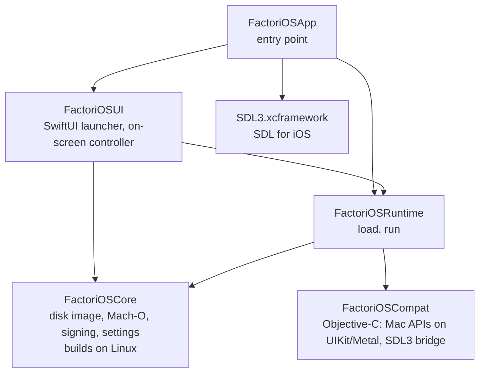
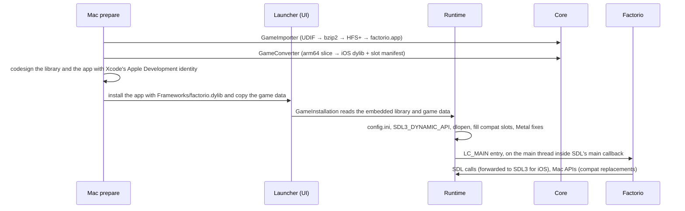

# Architecture

FactoriOS turns the player's Factorio for macOS into something iOS will run, without changing what the game does.
Five modules, one direction of dependency:

## From disk image to running game

At start-up `AppEntry.run` hands the application to `SDL_RunApp`, because SDL for iOS only pumps events for a main
function it started itself (see feasibility.md). SDL's callback shows the launcher in a window and runs the main run
loop until the player starts the game; the game's entry point then runs in that same callback. The game's static
state can't be run twice, so when the game ends the app exits; when the game asks to restart itself (`execv`), FactoriOS
says so and the player reopens it.

## Modules and their public API

Each entry names a file and the declarations it must contain; `mise run check-architecture` checks them against the
sources.

### FactoriOSCore: disk image

UDIF disk images with bzip2, zlib, raw and zero chunks; HFS+ and HFSX volumes with hard links and symlinks.

- `Sources/FactoriOSCore/DiskImage/RandomAccessSource.swift`: `RandomAccessSource`, `FileSource`
- `Sources/FactoriOSCore/DiskImage/UDIFImage.swift`: `UDIFImage`, `UDIFPartition`, `UDIFImage.open`, `UDIFImage.hfsPartition`
- `Sources/FactoriOSCore/DiskImage/BZip2.swift`: `BZip2`, `BZip2.decompress`
- `Sources/FactoriOSCore/DiskImage/Inflate.swift`: `Inflate`, `Inflate.decompressZlib`
- `Sources/FactoriOSCore/DiskImage/HFSPlusVolume.swift`: `HFSPlusVolume`, `HFSPlusVolume.lookup`, `HFSPlusVolume.children`
- `Sources/FactoriOSCore/DiskImage/HFSPlusVolume+Extraction.swift`: `HFSPlusVolume.extract`
- `Sources/FactoriOSCore/DiskImage/HFSItem.swift`: `HFSItem`, `HFSItem.Kind`
- `Sources/FactoriOSCore/DiskImage/DiskImageError.swift`: `DiskImageError`, `ExtractionProgress`
- `Sources/FactoriOSCore/DiskImage/GameImporter.swift`: `GameImporter`, `ImportedGame`, `GameImporter.importGame`, `GameImporter.installedGame`

### FactoriOSCore: Mach-O conversion

The game's arm64 slice becomes an iOS library: platform retagged, `MH_DYLIB` with `LC_ID_DYLIB`, one-page
`__PAGEZERO`, flat framework paths, Mac-only frameworks weak, CoreServices' load-time `_nan` binding redirected to
libSystem, their other binds weak-import, old signature removed, and the pointer slots of every replaced symbol
recorded.

- `Sources/FactoriOSCore/MachO/GameConverter.swift`: `GameConverter`, `GameConverter.convert`
- `Sources/FactoriOSCore/MachO/ConversionOptions.swift`: `ConversionOptions`, `MachOVersion`, `SymbolSlotManifest`, `ConvertedImage`
- `Sources/FactoriOSCore/MachO/MachOError.swift`: `MachOError`
- `Sources/FactoriOSCore/MachO/FatBinary.swift`: `FatBinary`
- `Sources/FactoriOSCore/MachO/LoadCommandTable.swift`: `LoadCommandTable`
- `Sources/FactoriOSCore/MachO/LoadCommandRewriter.swift`: `LoadCommandRewriter`
- `Sources/FactoriOSCore/MachO/BindStreamWalker.swift`: `BindStreamWalker`
- `Sources/FactoriOSCore/MachO/LibraryLinking.swift`: `LibraryLinking`

### FactoriOSCore: code signing

A portable embedded-signature implementation: CodeDirectory 0x20400 (SHA-256, 4 KiB pages), empty requirements,
optional entitlements (XML and DER), and a detached CMS SignedData with Apple's CDHash attributes, built with
SwiftASN1. The Mac prepare task delegates signing to `codesign` so Xcode's provisioning identity is applied exactly as
it is to the app; the portable signer is kept for producing signatures without macOS tooling.

- `Sources/FactoriOSCore/CodeSigning/SigningIdentity.swift`: `SigningIdentity`
- `Sources/FactoriOSCore/CodeSigning/MachOSigner.swift`: `MachOSigner`, `MachOSigner.sign`
- `Sources/FactoriOSCore/CodeSigning/SigningError.swift`: `SigningError`
- `Sources/FactoriOSCore/CodeSigning/CodeSignatureBlobs.swift`: `CodeSignatureBlobs`, `CodeDirectory`
- `Sources/FactoriOSCore/CodeSigning/CMSSignature.swift`: `CMSSignature`
- `Sources/FactoriOSCore/CodeSigning/DEREntitlements.swift`: `DEREntitlements`
- `Sources/FactoriOSCore/CodeSigning/MachOSignatureLayout.swift`: `MachOSignatureLayout`

### FactoriOSCore: game, settings and controls

- `Sources/FactoriOSCore/Game/GamePaths.swift`: `GamePaths`, `GamePaths.standard`, `GamePaths.bundledLibrary`
- `Sources/FactoriOSCore/Game/GameLibrary.swift`: `GameLibrary`, `GameLibrary.redirectedSymbols`, `GameLibrary.convert`, `GameLibrary.write`, `GameLibrary.isBundled`
- `Sources/FactoriOSCore/Game/GameSettings.swift`: `GameSettings`, `GameSettings.SpriteQuality`, `GameSettings.FrameRate`, `GameSettings.Frame`
- `Sources/FactoriOSCore/Game/SettingsStore.swift`: `SettingsStore`, `SettingsStore.load`, `SettingsStore.save`
- `Sources/FactoriOSCore/Game/FactorioConfig.swift`: `FactorioConfig`, `FactorioConfig.update`, `FactorioConfig.write`
- `Sources/FactoriOSCore/Game/SaveLibrary.swift`: `SaveLibrary`, `SaveFile`, `SaveLibraryError`
- `Sources/FactoriOSCore/Game/LaunchRequest.swift`: `LaunchRequest`, `SessionEnd`
- `Sources/FactoriOSCore/Game/GameInput.swift`: `GameInput`, `PadButton`, `PadAxis`
- `Sources/FactoriOSCore/Game/PadLayout.swift`: `PadLayout`, `PadLayout.Placement`
- `Sources/FactoriOSCore/Game/PadControlID.swift`: `PadControlID`, `PadStick`, `PadControlKind`, `PadAnchor`
- `Sources/FactoriOSCore/Game/PadGeometry.swift`: `PadGeometry`, `PadPoint`
- `Sources/FactoriOSCore/Game/PadController.swift`: `PadController`, `PadControlState`, `PadFeedback`
- `Sources/FactoriOSCore/Game/PadLayoutEditor.swift`: `PadLayoutEditor`
- `Sources/FactoriOSCore/Game/TouchGestures.swift`: `TouchGestures`

The pad's geometry, touch handling, layout editing and game gestures live in Core so they compile and lint anywhere;
the UI only draws them and feeds them touches.

### FactoriOSRuntime

- `Sources/FactoriOSRuntime/AppEntry.swift`: `AppEntry`, `AppEntry.run`
- `Sources/FactoriOSRuntime/GameInstallation.swift`: `GameInstallation`, `GameInstallation.Stage`
- `Sources/FactoriOSRuntime/LaunchCoordinator.swift`: `LaunchCoordinator`, `LaunchCoordinator.launch`
- `Sources/FactoriOSRuntime/CompatTable.swift`: `CompatTable`
- `Sources/FactoriOSRuntime/GameLoader.swift`: `GameLoader`
- `Sources/FactoriOSRuntime/GameLaunchError.swift`: `GameLaunchError`
- `Sources/FactoriOSRuntime/GameSession.swift`: `GameSession`
- `Sources/FactoriOSRuntime/SDLGameInput.swift`: `SDLGameInput`
- `Sources/FactoriOSRuntime/RumbleHaptics.swift`: `RumbleHaptics`
- `Sources/FactoriOSRuntime/RuntimeWindows.swift`: `RuntimeWindows`, `PassthroughWindow`, `RestartPrompt`
- `Sources/FactoriOSRuntime/RuntimeLog.swift`: `RuntimeLog`
- `Sources/FactoriOSRuntime/PresentedFrames.swift`: `PresentedFrames`, `PresentedFrames.current`

The Mac prepare step imports and converts the game, signs the library with the identity that signs the app, and
embeds it in the app bundle; the launcher only finds the already-prepared library and game data. Launch: `config.ini`;
environment (`SDL3_DYNAMIC_API`, plus `MTL_DEBUG_LAYER` and `SDL_LOGGING` for detailed logs); stdout and stderr to
`Logs/game.log`; Metal fixes; `dlopen` of `Frameworks/factorio.dylib`; slots filled through `vm_protect`; the overlay
window above SDL's window (found through SDL's `SDL.window.uikit.window` property, inset by the Frame setting); then
the game's `LC_MAIN` entry. The FPS overlay samples the presentation hook's monotonic frame count; it does not depend
on Apple's developer-only Metal HUD.

### FactoriOSCompat

- `Sources/FactoriOSCompat/include/FactoriOSCompat.h`: `FOSSymbolReplacement`, `FOSCompatReplacements`, `FOSCompatWriteSlot`, `FOSCompatInstallMetalFixes`, `FOSCompatSetExecutablePath`, `FOSCompatSetRestartHandler`, `FOSCompatSetBackgrounded`, `FOSCompatSetFrameRateCap`, `FOSCompatPresentedFrameCount`, `FOSCompatSetWindowFrame`
- `Sources/FactoriOSCompat/include/FOSSDL.h`: `FOSSDLLoad`, `FOSSDLRunApp`, `FOSSDLSetMainReady`, `FOSSDLSetHint`, `FOSSDLAttachVirtualGamepad`, `FOSSDLSetGamepadButton`, `FOSSDLSetGamepadAxis`, `FOSSDLWarpMouse`, `FOSSDLScrollWheel`, `FOSSDLSetTextInputActive`, `FOSSDLGameWindow`
- `Sources/FactoriOSCompat/FOSAppKit.h`: `FOSColorSpace`, `FOSBitmapImageRep`, `FOSWorkspace`
- `Sources/FactoriOSCompat/FOSImageRep.m`: `FOSColorSpace`, `FOSBitmapImageRep`
- `Sources/FactoriOSCompat/FOSWorkspace.m`: `FOSWorkspace`
- `Sources/FactoriOSCompat/FOSReplacements.m`: `FOSCompatReplacements`, `fos_execv`, `fos_fork`, `fos_NSGetExecutablePath`
- `Sources/FactoriOSCompat/FOSMetalFixes.m`: `FOSCompatInstallMetalFixes`, `FOSCompatSetBackgrounded`, `FOSCompatSetFrameRateCap`, `FOSCompatPresentedFrameCount`
- `Sources/FactoriOSCompat/FOSSDL.m`: `FOSSDLLoad`, `FOSSDLRunApp`, `FOSSDLGameWindow`
- `Sources/FactoriOSCompat/FOSWindowFrame.m`: `FOSCompatSetWindowFrame`

#### Compatibility map

Every Mac API the game's own code reaches (from `docs/feasibility.md`), and what stands in for it on iOS. Symbol rows
are filled into the slots the converter recorded; Metal rows change the live Metal classes.

| Mac API | Member | FactoriOS | iOS backing |
|---|---|---|---|
| `_NSApp` | `fosNSApp` | `fosNSApp` | a nil object: the game's menu-bar code sends its messages to nil |
| `NSBitmapImageRep` | `imageRepWithData:` | `FOSBitmapImageRep` | ImageIO decode to 8-bit RGBA |
| `NSBitmapImageRep` | `bitmapData` | `FOSBitmapImageRep` | the decoded pixel buffer |
| `NSBitmapImageRep` | `bitsPerPixel` | `FOSBitmapImageRep` | 32 |
| `NSBitmapImageRep` | `samplesPerPixel` | `FOSBitmapImageRep` | 4 |
| `NSBitmapImageRep` | `pixelsWide` | `FOSBitmapImageRep` | image width |
| `NSBitmapImageRep` | `pixelsHigh` | `FOSBitmapImageRep` | image height |
| `NSBitmapImageRep` | `colorSpace` | `FOSBitmapImageRep` | the image's `FOSColorSpace` |
| `NSBitmapImageRep` | `bitmapImageRepByConvertingToColorSpace:renderingIntent:` | `FOSBitmapImageRep` | CoreGraphics redraw into the target space |
| `NSBitmapImageRep` | `bitmapImageRepByRetaggingWithColorSpace:` | `FOSBitmapImageRep` | same pixels, new space |
| `NSColorSpace` | `sRGBColorSpace` | `FOSColorSpace` | `CGColorSpace` sRGB |
| `NSColorSpace` | `genericRGBColorSpace` | `FOSColorSpace` | `CGColorSpace` generic RGB |
| `NSColorSpace` | `CGColorSpace` | `FOSColorSpace` | the wrapped `CGColorSpaceRef` |
| `NSWorkspace` | `sharedWorkspace` | `FOSWorkspace` | a singleton |
| `NSWorkspace` | `activateFileViewerSelectingURLs:` | `FOSWorkspace` | opens the folder in Files (`shareddocuments://`) |
| `_UAZoomEnabled` | `fos_UAZoomEnabled` | `fos_UAZoomEnabled` | `UIAccessibilityIsZoomEnabled` |
| `_IOPMAssertionCreateWithDescription` | `fos_IOPMAssertionCreateWithDescription` | `fos_IOPMAssertionCreateWithDescription` | `UIApplication.idleTimerDisabled` |
| `_IOPMAssertionRelease` | `fos_IOPMAssertionRelease` | `fos_IOPMAssertionRelease` | `UIApplication.idleTimerDisabled` |
| `_clGetPlatformIDs` | `fos_clGetPlatformIDs` | `fos_clGetPlatformIDs` | iOS has no OpenCL: `CL_PLATFORM_NOT_FOUND_KHR` |
| `_clGetDeviceIDs` | `fos_clGetDeviceIDs` | `fos_clGetDeviceIDs` | no OpenCL: `CL_DEVICE_NOT_FOUND` |
| `_clGetDeviceInfo` | `fos_clGetDeviceInfo` | `fos_clGetDeviceInfo` | no OpenCL: `CL_INVALID_DEVICE` |
| `_MTLCopyAllDevices` | `fos_MTLCopyAllDevices` | `fos_MTLCopyAllDevices` | `MTLCreateSystemDefaultDevice` in an array |
| `_MTLCopyAllDevicesWithObserver` | `fos_MTLCopyAllDevicesWithObserver` | `fos_MTLCopyAllDevicesWithObserver` | the same; iOS's one GPU never changes |
| `_MTLRemoveDeviceObserver` | `fos_MTLRemoveDeviceObserver` | `fos_MTLRemoveDeviceObserver` | nothing was registered |
| `_execv` | `fos_execv` | `fos_execv` | restart request: asks the player to reopen FactoriOS |
| `_fork` | `fos_fork` | `fos_fork` | iOS forbids it: `ENOSYS` |
| `__NSGetExecutablePath` | `fos_NSGetExecutablePath` | `fos_NSGetExecutablePath` | the imported game's executable path |
| `MTLDevice` | `newBufferWithLength:options:` | `FOSNewBuffer` | managed storage becomes shared |
| `MTLDevice` | `newBufferWithBytes:length:options:` | `FOSNewBufferBytes` | managed storage becomes shared |
| `MTLDevice` | `newBufferWithBytesNoCopy:length:options:deallocator:` | `FOSNewBufferNoCopy` | managed storage becomes shared |
| `MTLDevice` | `newTextureWithDescriptor:` | `FOSNewTexture` | managed storage becomes shared |
| `MTLTextureDescriptor` | `setStorageMode:` | `FOSSetStorageMode` | managed storage becomes shared |
| `MTLTextureDescriptor` | `setResourceOptions:` | `FOSSetResourceOptions` | managed storage becomes shared |
| `MTLBuffer` | `didModifyRange:` | `FOSBufferDidModifyRange` | nothing to do: unified memory |
| `MTLBlitCommandEncoder` | `synchronizeResource:` | `FOSBlitSynchronizeResource` | nothing to do: unified memory |
| `MTLBlitCommandEncoder` | `synchronizeTexture:slice:level:` | `FOSBlitSynchronizeTexture` | nothing to do: unified memory |
| `MTLDevice` | `isLowPower` | `FOSDeviceIsLowPower` | NO: one GPU |
| `CAMetalLayer` | `setDisplaySyncEnabled:` | `FOSLayerSetDisplaySyncEnabled` | stored; iOS always syncs |
| `CAMetalLayer` | `displaySyncEnabled` | `FOSLayerDisplaySyncEnabled` | the stored value |
| `MTLCommandBuffer` | `presentDrawable:` | `FOSPresentDrawable` | `presentDrawable:afterMinimumDuration:` for the FPS cap |
| `CAMetalLayer` | `nextDrawable` | `FOSNextDrawable` | waits while the app is in the background |

### FactoriOSUI

- `Sources/FactoriOSUI/LauncherFactory.swift`: `LauncherFactory`, `LauncherFactory.makeLauncher`, `LauncherFactory.makeOverlay`
- `Sources/FactoriOSUI/Launcher/LauncherModel.swift`: `LauncherModel`
- `Sources/FactoriOSUI/Launcher/LauncherScene.swift`: `LauncherScene`, `LauncherPage`
- `Sources/FactoriOSUI/Launcher/WelcomeView.swift`: `WelcomeView`
- `Sources/FactoriOSUI/Launcher/HomeView.swift`: `HomeView`
- `Sources/FactoriOSUI/Launcher/SettingsView.swift`: `SettingsView`
- `Sources/FactoriOSUI/Launcher/SavesView.swift`: `SavesView`, `SavesFolderDocument`
- `Sources/FactoriOSUI/Launcher/LogsView.swift`: `LogsView`, `LogReader`
- `Sources/FactoriOSUI/Launcher/PadLayoutEditorScreen.swift`: `PadLayoutEditorScreen`
- `Sources/FactoriOSUI/Overlay/OverlayViewController.swift`: `OverlayViewController`
- `Sources/FactoriOSUI/Overlay/GameTouchView.swift`: `GameTouchView`, `PassthroughView`
- `Sources/FactoriOSUI/Overlay/PadView.swift`: `PadView`
- `Sources/FactoriOSUI/Overlay/PadPainter.swift`: `PadPainter`
- `Sources/FactoriOSUI/Overlay/PadToolbar.swift`: `PadToolbar`, `PadTool`

Screens follow the Android launcher's features: welcome (build-and-install instructions when the prepared game is
missing), home (Continue the newest save, Main menu), settings (resolution, FPS cap, frame, sprite quality, light
graphics, FPS counter, detailed logs, vibration, controller layout), saves (import, export), logs (FactoriOS's and the
game's, copy all), and the Factorio folder in the Files app. The overlay draws the on-screen controller, turns touches on the game into
controller and mouse input (tap, double-tap-drag, long press, two-finger tap, pinch) and steps aside for a physical
controller.

### FactoriOSApp

- `Sources/FactoriOSApp/FactoriOSMain.swift`: `FactoriOSMain`, `FactoriOSMain.main`

### FactoriOSPrepare

The development Mac's `factorios-prepare` (host build only): `GameImporter`, then `GameLibrary.convert` and
`GameLibrary.write`, then `codesign` with the certificate that signed the device build. `mise run device` copies the
signed library and manifest into the app's `Frameworks` folder, re-signs the app, installs it, and copies the game data
into the app's Application Support/FactoriOS. The device needs neither the `.dmg` nor a `.p12`; iOS won't load code
from the data container.

- `Sources/FactoriOSPrepare/main.swift`: `Options`, `SourceStamp`, `importIfNeeded`, `sign`

## Deferred: verified only on a device

Nothing below has run on a device. CI compiles every target for `arm64-apple-ios17.0`, builds SDL3 and runs the static
checks, but that proves no device behaviour. Each item is **deferred, not verified**:

| Area | What has to be seen on a device |
|---|---|
| Build and install | The generated Xcode workspace builds, signs and installs FactoriOS, and the launcher opens on an iOS 17 or later device. |
| Provisioning | Xcode's automatic signing installs the app, `mise run device` re-signs it after embedding the library, and iOS still launches it. |
| Import | The game data copied into the app container is visible and writable through the Files app. Hard links, the extents overflow tree and compressed files were absent from the demo image, so those paths have never run on real data. |
| Signing | The embedded library, signed with the Personal Team Apple Development identity that provisioned FactoriOS, passes library validation and `dlopen`s from the app bundle (feasibility gate 1). |
| Loading | dyld accepts a macOS binary retagged as iOS; weak imports from missing frameworks resolve to zero; the slots fill. |
| SDL | The game's static SDL3 forwards to the bundled SDL3, and SDL's window, touch, audio and controllers work with the game's entry point running inside SDL's main callback (gate 2). |
| Metal | The 110 shaders compile on iOS; rendering with managed storage turned into shared storage; the frame-rate cap and background frame gate (gate 3). |
| Memory and CPU | The demo fits the device's memory limit and runs on its CPU (gate 4). |
| Compatibility layer | Each replacement in the table below behaves as the game expects (image decoding above all). |
| Launcher and controller | Every screen, the on-screen controller, layout editor, touch gestures, haptics, physical controllers and keyboards. |
| Restart | The game's `execv` restart request reaches the player as "reopen FactoriOS". |
