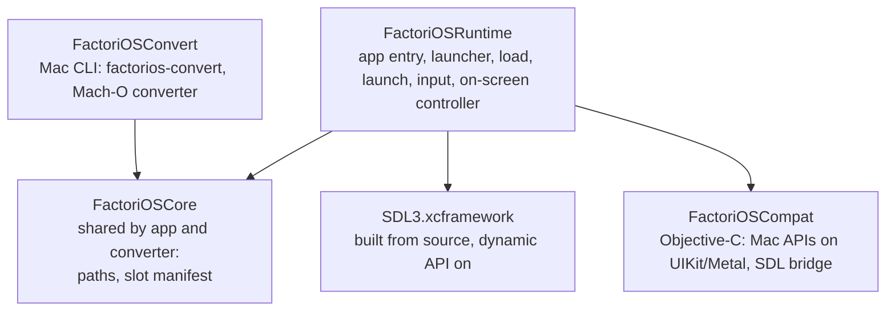
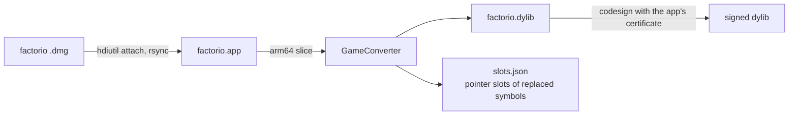
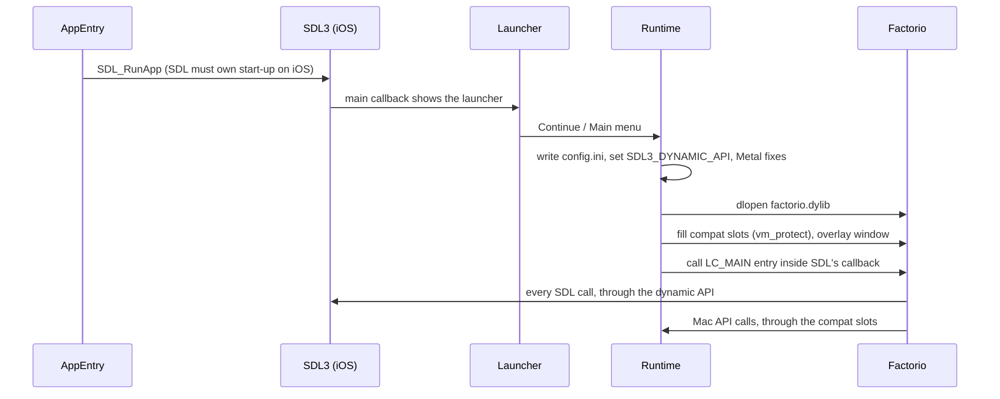

# Architecture

FactoriOS loads Factorio's unmodified macOS game code into an iOS app. It changes how the code is packaged and which
system calls it reaches. The game logic stays the same.

## Modules

| Module | Main types |
|---|---|
| `FactoriOSCore` | `GamePaths`, `GameLibrary` (redirected symbols), `SymbolSlotManifest`, JSON file helpers |
| `FactoriOSRuntime` | `Game`: `AppEntry`, `GameSession`, `GameLoader`, `CompatTable`, `SDLGameInput` · `Controls`: `PadLayout`, `PadController`, `TouchGestures` · `Overlay`: `OverlayViewController`, `PadView` · `Settings`: `GameSettings`, `FactorioConfig` · `Launcher`: `LauncherScene`, `SaveLibrary` |
| `FactoriOSCompat` | `FOSReplacements.m`, `FOSMetalFixes.m`, `FOSTextureCompression.m`, `FOSSDL.m`, `FOSWindowFrame.m` |
| `FactoriOSConvert` | `main.swift`, `GameConverter`, `LoadCommandRewriter`, `BindStreamWalker`, `FatBinary` |

## Preparing the game on the Mac

[`deploy`](../mise-tasks/deploy) does every step: macOS mounts the disk image, `factorios-convert` converts, and
`codesign` signs.

The converter's changes to the arm64 slice:

| Change | Why |
|---|---|
| Platform retagged to iOS (`LC_BUILD_VERSION`) | dyld refuses macOS binaries in an iOS process |
| `MH_EXECUTE` → `MH_DYLIB`, `LC_ID_DYLIB` added, `LC_LOAD_DYLINKER` dropped | so it can be `dlopen`ed |
| 4 GB `__PAGEZERO` shrunk to one page | a running process can't map it; LiveContainer does the same |
| Framework paths flattened (`Versions/A/` removed) | iOS frameworks are flat |
| Mac-only frameworks and their binds made weak | they resolve to zero; the compat layer fills what the game reaches |
| CoreServices `_nan` rebound to libSystem | the only Mac-only import reached while the library loads |
| Old signature removed, slots recorded | re-signed on the Mac; slots are patched after `dlopen` |

Shaders ship as Metal source, which iOS compiles at run time. iOS loads code only from inside the app bundle, so the
signed library is embedded in the app ([`deploy`](../mise-tasks/deploy)) and the game data goes to the app's
`Library/Application Support/FactoriOS/Game`.

## Launch

- **SDL hand-over:** the game links SDL3 statically with the dynamic API left on. `SDL3_DYNAMIC_API` points it at
  FactoriOS's SDL3, so window, `CAMetalLayer`, touch, audio and controllers use SDL's UIKit backend. SDL's official iOS
  build compiles the dynamic API out, so [`sdl3`](../mise-tasks/sdl3) builds it from the `External/SDL` submodule with the switch on.
- **One run per process:** the game's static state can't be reset, so the app exits when the game ends. An `execv`
  restart request becomes a "reopen FactoriOS" prompt.
- **Load-time safety:** `dlopen` runs 449 static initializers before the slots are filled. None of them reaches a
  replaced symbol.
- **Background:** iOS forbids GPU work in the background, so `nextDrawable` waits until the app is active again.
- **Paths:** `config.ini` sets `read-data` to the imported game and `write-data` to `Documents/Factorio`, which the
  Files app shows.

## Compatibility map

Every Mac API the game's own code reaches, and its iOS replacement. Symbol rows fill the slots the converter recorded.
Metal rows patch the live Metal classes.

| Mac API | Member | FactoriOS | iOS backing |
|---|---|---|---|
| `_NSApp` | `fosNSApp` | `fosNSApp` | nil: the game's menu-bar code messages nil |
| `NSAppleEventManager` | `FOSAppleEventManager` | `FOSAppleEventManager` | empty class; only the unused static SDL Cocoa backend messages it |
| `NSBitmapImageRep` | `imageRepWithData:` | `FOSBitmapImageRep` | ImageIO decode to 8-bit RGBA (the game's PNG sprite loader) |
| `NSBitmapImageRep` | `bitmapData` | `FOSBitmapImageRep` | the decoded pixel buffer |
| `NSBitmapImageRep` | `bitsPerPixel` | `FOSBitmapImageRep` | 32 |
| `NSBitmapImageRep` | `samplesPerPixel` | `FOSBitmapImageRep` | 4 |
| `NSBitmapImageRep` | `pixelsWide` | `FOSBitmapImageRep` | image width |
| `NSBitmapImageRep` | `pixelsHigh` | `FOSBitmapImageRep` | image height |
| `NSBitmapImageRep` | `colorSpace` | `FOSBitmapImageRep` | the image's `FOSColorSpace` |
| `NSBitmapImageRep` | `bitmapImageRepByConvertingToColorSpace:renderingIntent:` | `FOSBitmapImageRep` | CoreGraphics redraw into the target space |
| `NSBitmapImageRep` | `bitmapImageRepByRetaggingWithColorSpace:` | `FOSBitmapImageRep` | same pixels, new space |
| `NSColorSpace` | `sRGBColorSpace` | `FOSColorSpace` | `CGColorSpace` sRGB |
| `NSColorSpace` | `genericRGBColorSpace` | `FOSColorSpace` | `CGColorSpace` generic RGB |
| `NSColorSpace` | `CGColorSpace` | `FOSColorSpace` | the wrapped `CGColorSpaceRef` |
| `NSWorkspace` | `sharedWorkspace` | `FOSWorkspace` | a singleton |
| `NSWorkspace` | `activateFileViewerSelectingURLs:` | `FOSWorkspace` | opens the folder in Files (`shareddocuments://`) |
| `_UAZoomEnabled` | `fos_UAZoomEnabled` | `fos_UAZoomEnabled` | false: iOS has no API to ask |
| `_IOPMAssertionRelease` | `fos_IOPMAssertionRelease` | `fos_IOPMAssertionRelease` | `kIOReturnNotFound`: no assertion was created |
| `_clGetPlatformIDs` | `fos_clGetPlatformIDs` | `fos_clGetPlatformIDs` | no OpenCL: `CL_PLATFORM_NOT_FOUND_KHR` |
| `_clGetDeviceIDs` | `fos_clGetDeviceIDs` | `fos_clGetDeviceIDs` | `CL_INVALID_PLATFORM` |
| `_clGetDeviceInfo` | `fos_clGetDeviceInfo` | `fos_clGetDeviceInfo` | `CL_INVALID_DEVICE` |
| `_MTLCopyAllDevices` | `fos_MTLCopyAllDevices` | `fos_MTLCopyAllDevices` | `MTLCreateSystemDefaultDevice` in an array |
| `_MTLCopyAllDevicesWithObserver` | `fos_MTLCopyAllDevicesWithObserver` | `fos_MTLCopyAllDevicesWithObserver` | the same; the one GPU never changes |
| `_MTLRemoveDeviceObserver` | `fos_MTLRemoveDeviceObserver` | `fos_MTLRemoveDeviceObserver` | nothing was registered |
| `_execv` | `fos_execv` | `fos_execv` | restart request: asks the player to reopen FactoriOS |
| `_fork` | `fos_fork` | `fos_fork` | `ENOSYS`: iOS forbids it |
| `__NSGetExecutablePath` | `fos_NSGetExecutablePath` | `fos_NSGetExecutablePath` | the imported game's executable path |
| `MTLDevice` | `newBufferWithLength:options:` | `FOSNewBuffer` | managed storage becomes shared |
| `MTLDevice` | `newBufferWithBytes:length:options:` | `FOSNewBufferBytes` | managed storage becomes shared |
| `MTLDevice` | `newBufferWithBytesNoCopy:length:options:deallocator:` | `FOSNewBufferNoCopy` | managed storage becomes shared |
| `MTLDevice` | `newTextureWithDescriptor:` | `FOSNewTexture` | managed → shared; without BC support, BC1-BC5 become the uncompressed format with the same channels |
| `MTLTextureDescriptor` | `setStorageMode:` | `FOSSetStorageMode` | managed storage becomes shared |
| `MTLTextureDescriptor` | `setResourceOptions:` | `FOSSetResourceOptions` | managed storage becomes shared |
| `MTLBuffer` | `didModifyRange:` | `FOSBufferDidModifyRange` | no-op: unified memory |
| `MTLBlitCommandEncoder` | `synchronizeResource:` | `FOSBlitSynchronizeResource` | no-op: unified memory |
| `MTLBlitCommandEncoder` | `synchronizeTexture:slice:level:` | `FOSBlitSynchronizeTexture` | no-op: unified memory |
| `MTLDevice` | `isLowPower` | `FOSDeviceIsLowPower` | NO: one GPU |
| `MTLDevice` | `isDepth24Stencil8PixelFormatSupported` | `FOSDeviceIsDepth24Stencil8PixelFormatSupported` | NO: Apple GPUs lack the format |
| `MTLBlitCommandEncoder` | `copyFromBuffer:…toTexture:…destinationOrigin:` | `FOSCopyBufferToTexture` | without BC: `FOSBCDecode` on the CPU, then the decoded copy |
| `CAMetalLayer` | `setDisplaySyncEnabled:` | `FOSLayerSetDisplaySyncEnabled` | stored; iOS always syncs |
| `CAMetalLayer` | `displaySyncEnabled` | `FOSLayerDisplaySyncEnabled` | the stored value |
| `MTLCommandBuffer` | `presentDrawable:` | `FOSPresentDrawable` | `presentDrawable:afterMinimumDuration:` for the FPS cap |
| `CAMetalLayer` | `nextDrawable` | `FOSNextDrawable` | waits while the app is in the background |

**BC textures:** iPhone GPUs report no BC texture compression, while Factorio's Metal renderer assumes it. The compat
layer creates BC textures uncompressed and decodes uploads on the CPU (BC1-BC3 bit-exact, BC4/5 within 8-bit
rounding). FactoriOS also sets `texture-compression-level=none`, so the game produces no BC data itself. Uncompressed
sprites cost memory, which is why High sprite quality doesn't fit an iPhone's ~3.2 GB.

## Prior art

[LiveContainer](https://github.com/LiveContainer/LiveContainer) turns iOS executables into libraries the same way
(`MH_DYLIB`, one-page `__PAGEZERO`, `LC_ID_DYLIB` first) and signs them with the host app's certificate when JIT is
unavailable. FactoriOS's converter is an independent implementation from the Mach-O format. The new step is retagging
a macOS binary for iOS.

## Device status

| Area | Status |
|---|---|
| Import, conversion, signing, loading | Verified with Factorio 2.1.24 on an iPhone 14 (iOS 26) |
| SDL: window, touch, keyboard, audio | Verified |
| Metal: rendering at native resolution, 60 FPS | Verified |
| Memory | Medium sprites fit; High exceeds the ~3.2 GB limit |
| On-screen controller, gestures, layout editor | Verified |
| Physical controllers | Unverified |
| Restart prompt (`execv`) | Unverified |
