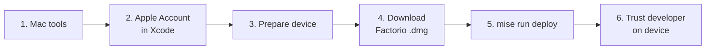
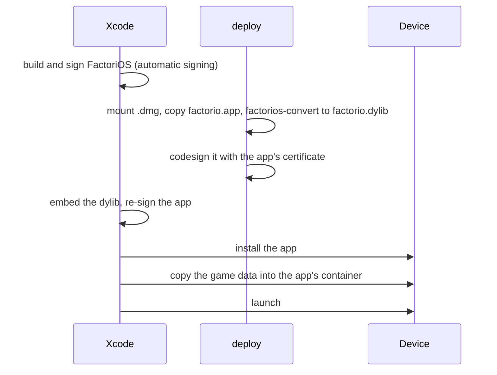

# Getting started

Build FactoriOS on a Mac and install it with your copy of Factorio on your iPhone or iPad. Other host platforms
aren't supported yet.



## Requirements

| What | Notes |
|---|---|
| Mac | A macOS version that runs the current Xcode |
| [Xcode](https://apps.apple.com/app/xcode/id497799835) | The full app, not only the Command Line Tools, with the iOS platform installed |
| [mise](https://mise.jdx.dev/getting-started.html) | Installs the pinned Swift, xtool and linters |
| iPhone or iPad | arm64, iOS 17 or later, connected with a cable. Tested on an iPhone 14 |
| Apple Account | A free account works (Personal Team) |
| Factorio for macOS | The `.dmg` from [`factorio.com/download`](https://factorio.com/download); the demo works |

## 1. Mac tools

```sh
xcode-select -p                 # should print /Applications/Xcode.app/Contents/Developer
sudo xcode-select -s /Applications/Xcode.app   # if it printed CommandLineTools
git clone --recurse-submodules https://github.com/kmnft/factorios.git && cd factorios
mise trust && mise install
```

Open Xcode once so it finishes installing its components and the iOS platform.

## 2. Apple Account in Xcode

In Xcode, open **Settings → Accounts**, click **+** and sign in. A free account creates a *Personal Team*. Xcode creates
the signing certificate and provisioning profile on the first build.

## 3. Prepare the device

1. Connect the iPhone or iPad with a cable, unlock it and tap **Trust** for this Mac.
2. Turn on **Settings → Privacy & Security → Developer Mode** and restart when asked. The option appears after the
   device has been connected to Xcode once.

## 4. Download Factorio

Download Factorio for macOS from [`factorio.com/download`](https://factorio.com/download) into `~/Downloads` (or into
`artifact/` in the repository). `mise run deploy` picks the newest `factorio*mac*.dmg` from either place.

## 5. Build and install

```sh
mise run deploy
```

There is nothing to configure: `deploy` finds the connected device, your Xcode team and the newest `.dmg` itself. Only
if it finds several and stops, pick one as it tells you, for example
`mise set --file mise.local.toml FACTORIOS_DEVICE_ID=UDID`. That file stays on your Mac.

The first run takes a while: it builds SDL3 from the `External/SDL` submodule, the app, and the Mac converter,
imports the disk image and converts the game. Later runs reuse all of that and copy only changed game files.



## 6. First launch

iOS blocks apps from a new developer until you trust it: **Settings → General → VPN & Device Management**, select your
Apple Account, tap **Trust**, and open FactoriOS. The launcher opens on its home screen. Tap **Main menu** to start
Factorio. [Playing](playing.md) covers the controls.

## Keeping it running

- **Free accounts:** the provisioning profile expires after 7 days, and the app then stops launching. Run
  `mise run deploy` again; your saves stay. A free account allows 3 devices and 3 sideloaded apps per device.
- **New Factorio version:** download the new `.dmg`, run `mise run deploy`; it picks the newest image unless
  `FACTORIOS_DMG` is set.

Something failed? See [Troubleshooting](troubleshooting.md).
