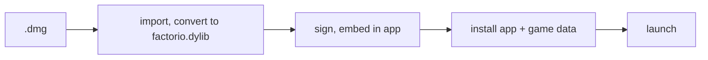

# Getting started

Build FactoriOS on a Mac and install it with your copy of Factorio.

## Requirements

- Mac with the full [Xcode](https://apps.apple.com/app/xcode/id497799835) and its iOS platform
- [mise](https://mise.jdx.dev/getting-started.html)
- iPhone or iPad, iOS 17+, connected by cable, or the iOS Simulator on an Apple silicon Mac
- Apple Account signed in under Xcode → Settings → Accounts (a free one works; not needed for the simulator)
- Factorio for macOS `.dmg` from [factorio.com/download](https://factorio.com/download) in `~/Downloads` or
  `artifact/` (the demo works; the newest is used)

## Setup

```sh
sudo xcode-select -s /Applications/Xcode.app   # if `xcode-select -p` shows CommandLineTools
git clone --recurse-submodules https://github.com/kmnft/factorios.git && cd factorios
mise trust && mise install
```

On the device: unlock it, tap **Trust** for this Mac, and turn on Settings → Privacy & Security → **Developer Mode**.

## Install and run

```sh
mise run deploy            # device
mise run simulator:build   # simulator; later: mise run simulator:launch
```

`deploy` finds the device, team and `.dmg` itself. If it finds several, it tells you what to set, for example
`mise set --file mise.local.toml FACTORIOS_DEVICE_ID=UDID`. The first run builds SDL3 and converts the game, so it
takes a while.



On a device, trust the developer once: Settings → General → VPN & Device Management → your account → **Trust**. Then
open FactoriOS and tap **Main menu**. See [Playing](playing.md).

## Keeping it running

- A free account's profile expires after 7 days: run `mise run deploy` again. Saves stay.
- New Factorio version: download the `.dmg` and run `deploy` again.

Problems: [Troubleshooting](troubleshooting.md).
