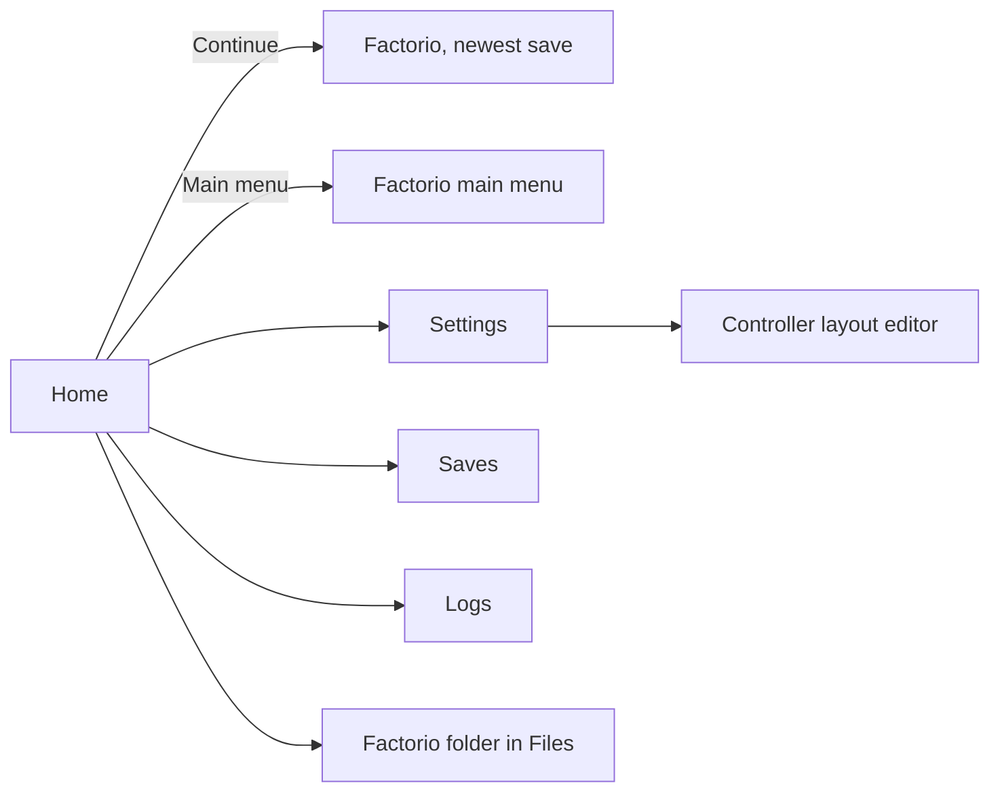

# Playing

## Launcher

Factorio's state can't be reset inside one process, so leaving the game closes FactoriOS. Open it again to return to
the launcher. When the game asks to restart itself (after changing mods, for example), FactoriOS tells you to reopen it.

## Settings

Settings apply the next time the game starts.

| Setting | Options | Notes |
|---|---|---|
| Frame rate | 30, **60** FPS | The game still runs 60 updates a second; 30 FPS saves battery and heat |
| Frame | **Off**, Thin, Wide | A margin that keeps rounded screen corners off the game's menus |
| UI size | **Large**, Medium, Small | Factorio's UI scale, matched to a 720, 900 or 1080 pixel monitor |
| Sprite quality | High, **Medium** | Keep Medium on iPhones: High needs about 4.3 GB and iOS ends the game while it loads |
| Light graphics | on, **off** | Turns off smoke, clouds, decoratives, particles, shadows and terrain effects |
| FPS counter | on, **off** | FactoriOS's own counter of presented frames |
| Detailed logs | on, **off** | Metal validation and verbose SDL logging, for bug reports |
| Vibration | **on**, off | Haptics for the game's rumble and the on-screen buttons |

Bold marks the default.

## Controls

FactoriOS puts Factorio in controller mode and draws a gamepad over the game. A connected keyboard and mouse switch
the game to keyboard-and-mouse mode. A physical controller hides the on-screen pad.

| Gesture on the game | Does |
|---|---|
| Tap | Moves the cursor there and presses A |
| Drag | Moves the cursor |
| Double tap, hold and drag | Holds A along the drag |
| Long press | Holds X, the cursor following the finger |
| Two-finger tap | B |
| Pinch | Zooms (Factorio's RT + D-pad up/down) |
| Two-finger drag | Scrolls, like a mouse wheel |

The toolbar at the top of the screen:

| Button | Does |
|---|---|
| Sliders | Opens the layout editor: add, remove, resize and move controls, or reset them |
| Half circle | Steps through the controls' opacity |
| Eye | Hides or shows the controls |
| Keyboard | Shows or hides the system keyboard while a game text field has focus |

## Saves and files

- **Saves** imports and exports `.zip` saves.
- The **Factorio folder** (saves, mods, `config.ini`) appears in the Files app under *On My iPhone → FactoriOS*.
- **Logs** shows FactoriOS's log and the game's, with a button to copy both for a bug report.
